<p align="center">
  
</p>

<p align="center">
  <a href="https://github.com/Dylgas?tab=followers"></a>
  
  <a href="https://github.com/Dylgas?tab=repositories"></a>
</p>

<br>


I build tools for real-world problems — right now that means software for **live event A/V** and **developer templates with docs people actually enjoy reading**. I like clean structure, good documentation, and a little bit of motion.

```ts
const echo = {
  building:  ["Talk Back A/V Monitor", "Overall"],
  focus:     ["Live event A/V tooling", "Developer docs & templates"],
  values:    ["Ship it", "Document it", "Make it look good"],
  funFact:   "My READMEs have more animations than most websites",
};
```

<br>


<p align="center">
  <a href="https://github.com/Dylgas/talk-back-av-monitor"></a>
  <a href="https://github.com/Dylgas/Overall"></a>
</p>

| Project | What it is | Status |
|---|---|:-:|
| 🎚️ **[Talk Back A/V Monitor](https://github.com/Dylgas/talk-back-av-monitor)** | One screen to monitor everything happening at show site — live event audio & video |  |
| 🧭 **[Overall](https://github.com/Dylgas/Overall)** | Project template with an animated docs wiki, 30-page knowledge base, and docs website |  |

<br>


<p align="center">
  <a href="https://skillicons.dev">
    
  </a>
</p>

<br>


<p align="center">
  
  
</p>

<p align="center">
  
</p>

<p align="center">
  <picture>
    <source media="(prefers-color-scheme: dark)" srcset="https://raw.githubusercontent.com/Dylgas/Dylgas/output/github-snake-dark.svg">
    <source media="(prefers-color-scheme: light)" srcset="https://raw.githubusercontent.com/Dylgas/Dylgas/output/github-snake.svg">
    
  </picture>
</p>

<p align="center">
  
</p>
